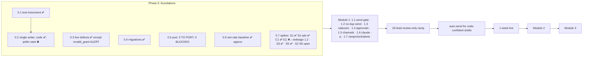

# End-to-end status: lead in → reply out → nothing forgotten → paid

**Reader:** Claude Code, at the start of every session in this repo (HANDOFF's top line and its "Prompt for Next
Session" point here). **Trigger to update:** any checklist row changes state. Update it in the same commit as the
work, never later. **Owner:** whichever session changes the row.
**Last verified against sources:** 2026-10-09 (`f789b53`..`67360be`), by the price-block session.
**Refreshed 2026-10-14** (`33daaee`, the lead_words session): the V1 port count was re-run (unchanged: 197 / 171 / 35 / 3),
and the draft-quality section, the Module 1 send-path notes and the critical path were updated from their solution docs
and records. **The Phase 0 and spike rows above were NOT re-verified in this refresh and keep their own dates** (poller
not started, S2 and S6 open: nothing in this session's work touched them).
**Updated 2026-10-16** (session after `2455b63`): the poller WAS started once on 2026-10-14 evening with Alex's yes (row 0.2 step 5), a token-usage log and a one-message ingest script were added, and the Yelp findings are recorded (todos 094, 095). Only the rows named in this paragraph changed; no other row was re-verified.

> **Trust rule.** This file is a map, not evidence. Every status row names its SOURCE and a VERIFY command or
> location. Before acting on a row, or quoting it to Alex as fact, re-check it at the source. If the source
> disagrees, fix THIS file and say so. On 2026-10-09 three trackers were stale at once: HANDOFF said "29 TO PORT"
> (source: 19); the `## UNEXECUTED` table in `spikes.md` still listed C1a (PASSED 10-03) and G1 (FAILED 10-03) and
> said the manifest "does not exist yet" (this file's first version trusted it for G1, and G1 was needlessly re-run); project memory said "LIVE on Railway" (stopped 10-03). A summary table is never the
> source.

## The plan (source: `docs/plans/2026-10-02-booking-hub-roadmap.md`, Alex 2026-10-02)

```
 PHASE 0 foundations ──► MODULE 1 lead replies ──► 1 week live ──► MODULE 2 nothing forgotten ──► 1 week live ──► MODULE 3 money
   (in progress)          (plan written,          (0 unresolved      (NOT planned: write the plan       (NOT planned)
                           not started)            ALERT FAILED)       only after M1 runs a week)
```



**Fixed decisions (do not re-derive; source: the roadmap's Decisions table):** host = Alex's MacBook (lid open,
charger, `caffeinate`), not Railway. Drafting = `claude -p` on Claude Max, never an API key. Code decides
"confident"; auto-send only after a 20-lead review-only ramp. GigSalad = email reply (Chrome fallback). Yelp =
approve-only, with AI disclosure. Alerts = iMessage to self, read back (Telegram only if that fails; no Twilio).
Success measures: win rate above the 0.6 baseline at 3 months; ≥80% of GigSalad leads answered within 1 hour;
then 0 off-calendar gigs / 0 missed money or COI dates; then hours back.

## Checklist: Phase 0 (plan: `docs/plans/2026-10-02-feat-hub-phase0-lead-replies-plan.md` §0.1–0.7)

| ☐/☑ | Item | Status (verified 2026-10-09) | Source / verify | Owner · blocker |
|---|---|---|---|---|
| ☑ | 0.1 test instrument (`test:match`) | PASSED 10-03 | `spikes.md` row "0.1 `test:match` instrument" | — |
| ☑ | 0.2 code: single writer, lease | done | HANDOFF header; plan §0.2 | — |
| ☐ | 0.2 step 5: **start the Mac poller** | **Started once, DRY RUN only, 2026-10-14 evening PDT, with Alex's explicit yes (he chose "start it, poller included"); stopped 2026-10-16 when he stopped the server.** Observed (server log, `poller_state`): Gmail token refreshed fine at startup, the poller ran every 60 s, GigSalad music and business logins reported EXPIRED. It only reads mail newer than its cursor (set to the start time), so a lead that arrived before the start is never seen; `scripts/ingest-one.ts <gmail-id>` feeds one message through the same path. The row stays open: no real lead was polled end to end, S6 (overnight, catch-up) is still not run, and it is NOT running now. | `spikes.md` row "0.2 step 4" | **Alex only. HARD GATE: never start it against real mail without his explicit yes** |
| ☐ | 0.3 `invalid_grant` ALERT half | not written (`alert.ts` can't deliver until Module 1) | `spikes.md` row "0.3 `/health` fields" | Claude, inside Module 1.7 |
| ☑ | 0.3 other live defects, 0.4 migrations | done | `spikes.md` 0.3 rows; HANDOFF header | — |
| ☐ | **0.5 port: 3 TO PORT, 0 BLOCKED** | TO PORT: R006 (own plan), R398 (Module 1), R403 (NP1/NP3/NP2 3-4h/NP duo prices still open). T4 reference lead R020–R025 PORTED and R329 NOT PORTED 2026-10-12 (plan `docs/plans/2026-10-11-feat-t4-reference-lead-plan.md`). Venues R081–R085, R087–R089, R405 PORTED 2026-10-11 (R085 La Valencia, R089 Scripps added later the same day, Alex). **Every venue sentence is to be rewritten by Alex after the venue-database data pull** (`docs/brainstorms/2026-10-11-venue-database-seed.md`) (private `~/Data` file; plan `docs/plans/2026-10-11-feat-venue-history-private-file-plan.md`) | `port-manifest.md`; count with **V1** below | Claude; **any new or changed price needs Alex's numbers** |
| ☑ | **0.6 win-rate baseline** | **DONE (approximate) 10-09**: ~415 inquiries (GigSalad 247 threads + Yelp 168 messages) vs 24 paid performances (all sources) | `docs/research/2026-10-02-booking-hub/baseline.md` | Design gap for Module 1: trace each gig to its lead source (GigSalad Booked status is not a win count: Alex books off-platform) |
| ☑ | S1, S1-adv (locked `claude -p`, injection) | PASSED 10-03 | `spikes.md` `## Executed` | — |
| ☑ | C1 (Railway stopped; C1b waived by Alex) | PASSED 10-03 | `spikes.md` rows C1a, C1b. ⚠ GitHub auto-deploy note there | — |
| ☑ | G1 Gmail supplied Message-ID | **FAIL 10-03** (Gmail replaces it; search verified by controls); repeated 10-09, same result | `spikes.md` G1 result rows (NOT the UNEXECUTED table) | **Consequence: plan §1.2 duplicate-send recovery must be redesigned** (candidates: body/subject token, or the Gmail id from the send response); auto-send stays off until then |
| ☐ | S2 GigSalad email reply lands on platform | not run. **No prior evidence either way:** Alex has never replied to GigSalad by email (he replies in the portal; Alex 2026-10-11) | `## UNEXECUTED` row S2 | **Alex**, on the next real GigSalad lead |
| ☑ | S3 iMessage to self + read-back | **PASSED 10-09** (sent + delivered, read back from `chat.db`; Alex confirmed on iPhone) | `spikes.md` row "S3: iMessage to self + read-back \| 2026-10-09" | Finding: self-messages create two rows; only `is_from_me=1` is Alex |
| ☑ | S5 Gmail token valid on day 8 | **PASSED 10-11** 00:00 PDT (7 d 16 h after the production sign-in; refresh token used: loader refreshed and rewrote the token file) | `spikes.md` row "S5: token valid on day 8 \| 2026-10-11"; probe `evidence/s5-probe.ts` | No weekly re-auth needed. Revocation (password change, 6 months unused) still ends it: that is the `invalid_grant` alert in 0.3 |
| ☐ | S6 overnight awake + catch-up | **half known:** Alex reports the Mac stays awake overnight (2026-10-11). The app's catch-up (`wake-watch.ts` → `pollNow()`) has never run for real: the poller has never been started (needs Alex's yes). Stays open until one real night with the app running | row S6 | Alex (a night, after the poller starts) |
| ☐ | FileVault restart after an OS update | not run | row FileVault | Alex (next macOS update) |

**V1 (port count by status column; known answer 2026-10-12 (after the T4 reference lead): 197 ALREADY PRESENT, 171 PORTED, 35 NOT PORTED,
3 TO PORT, 0 BLOCKED, 406 total; was 165 PORTED / 10 TO PORT on 2026-10-11, 156 / 19 on 2026-10-09):**

```
awk -F'|' '/^\| R[0-9]+ \|/{s=$5; gsub(/^ +| +$/,"",s); c[s]++} END{for(k in c) print c[k], k}' docs/research/2026-10-02-booking-hub/port-manifest.md
```

## Draft-quality work inside Phase 0 (2026-10-13..14; each row: what it does, source, what is open)

*Cost visibility (2026-10-15):* every real API call now appends tokens to `logs/usage.jsonl` (gitignored; `src/claude.ts`), and `npx tsx scripts/usage-report.ts` sums it per day and model. The dollar column uses list prices written from memory (Sonnet $3 / $15 per million): check them before trusting it. First measurement: one made-up Yelp lead run through `src/index.ts` = 7 calls, 80,460 in / 6,320 out, about $0.34 (the gate failed 3 times; most of the cost is the two retries). Lines are not tagged with a lead id.

| Cycle | State | Source | Still open |
|---|---|---|---|
| COI sentence is app-owned and checked on every send path | DONE, code review R2 GO. A draft without the right sentence FAILS; the approve route refuses stored drafts without it | `docs/solutions/architecture/2026-10-13-coi-sentence-owned-by-the-app-and-every-send-surface.md` | **Module 1 send paths (1.1, 1.4) must apply `coiViolations`** (see the note under Module 1) |
| Clarification: validator rejects stated prices, not vocabulary | DONE | `docs/solutions/architecture/2026-10-13-clarification-validator-rejects-stated-prices-not-vocabulary.md` | "exactly one question" is the next failure |
| Clarification: internal pricing terms rejected as compounds only | DONE (Alex decided: bare words pass) | `docs/solutions/architecture/2026-10-13-internal-pricing-terms-are-rejected-as-compounds-not-as-words.md` | anchor/floor false rejects |
| Clarification: gate opening rule scoped; draft shape | DONE, measured: 0 to 2 of 16 verified; a shorter reply moved the primary 38% to 34% (null) | `docs/solutions/architecture/2026-10-13-verify-gate-asked-a-vague-lead-for-a-detail-it-never-gave.md`; `...-a-shorter-instruction-shortens-the-reply-not-the-scene-two-arm-measurement.md` | the scene gap (needs Alex's reference reply) |
| Vague-lead quote route | DONE and in code: a vague one-question lead with no ensemble word gets a solo or duo default quote plus one binary question (`defaultVagueFormat`). Measured: price present 50 of 50, verified 9 to 11 of 50 | `docs/solutions/architecture/2026-10-14-vague-lead-quote-route-default-in-code-and-the-gate-it-left-behind.md`; plan `docs/plans/2026-10-13-feat-vague-lead-quote-with-question-plan.md` | the verifier still fails most of these on the opening; copying (30 of 50 clause windows); length (median ~197 words vs ~100) |
| Verify-gate scoping for the quoted vague lead (`vagueQuoteMode`) | BUILT, measured, **not distinguishable from noise** (6 changed to pass, 2 to fail, p 0.145; noise 2 of 50) | `docs/plans/2026-10-14-fix-vague-quote-gate-opening-plan.md`; solution doc below | none by itself: it has nothing to cite |
| `lead_words` field (the lead's own occasion, time frame, doubt) | **BUILT, MEASURED, STOPPED, REVERTED.** The classifier prompt edit moved L1 wedding's format and price 15 of 15; control B2 passed a generic opening 6 of 6. `src/prompts/classify.ts` is back to its original bytes (SHA-256 eb8c9b54). The field and its drafter and verifier sections stay in code and are INERT (all-null equals today's text) | `docs/solutions/architecture/2026-10-14-lead-words-field-measured-stopped-and-reverted-and-the-gate-scoping-that-did-not-help.md`; `docs/reviews/2026-10-14-lead-words-measurement.md` | a new route for the lead's own words (Alex's call); the verifier anchor B2 passes through |

**What this means for the path:** nothing here is sendable on its own. The router holds every vague `one_question` lead
for Alex (`src/automation/router.ts`, the "Vague lead — needs clarifying question" reason), and the post-check, COI and
payment checks and his own read remain. **Do not edit `src/prompts/classify.ts` without the regression gate**
(`npx tsx scripts/classifier-regression.ts --compare <before> <after>` must exit 0).
**No bar says when this work is enough to start Module 1: `todos/087-pending-p2-define-and-score-draft-quality-done-enough.md`.**

## Checklist: Module 1 (plan §1.1–1.7). Not started.

☐ 1.1 send gate (structured quote, one final check) · ☐ 1.2 no automatic duplicate send (`outbound_messages`;
**REDESIGN: G1 failed**) · ☐ 1.3 statuses + single completion path · ☐ 1.4 approvals · ☐ 1.5 channels · ☐ 1.6 `claude -p`
provider (`src/claude-cli.ts`; S1 proved the lockdown) · ☐ 1.7 ramp, clock, alerts (needs S3 or S4) ·
☐ 20-lead review-only ramp · ☐ auto-send on · ☐ 1 week live, 0 unresolved ALERT FAILED.
Gate (port manifest header): Module 1 cannot go live while any manifest row is `UNREVIEWED` or `BLOCKED`
(today: 0 and 0).
**Payment terms (2026-10-11):** every path that sends a STORED draft (1.1 send gate, 1.4 approvals) must call
`refreshPaymentSentence` (`src/pipeline/payment-terms.ts`) with today's `paymentTermsFor(...)` first and refuse on its
error, as `POST /api/leads/:id/approve` does; otherwise a draft approved days later carries the wrong payment band
(plan `docs/plans/2026-10-11-fix-payment-terms-by-lead-time-plan.md`, Revision 4).
**Tier B "use this price" (2026-10-12, Alex):** a held `tier_b:` lead shows the draft's price and both rate-card
prices, but nothing switches them; picking the other price today means editing the draft by hand before approving.
1.4 approvals must add a "use this price" action that re-drafts at the chosen tier (the edit path with the stored
classification, `rate_card_tier` set, prices from `lookupPrice`), so the pick is one click and the price line,
payment sentence and post-check all follow (plan `docs/plans/2026-10-12-fix-tier-b-venue-rule-conflict-hold-plan.md`,
Revision 6).
**COI sentence (2026-10-13):** every path that sends a draft (1.1 send gate, 1.4 approvals, any new send surface) must
apply `coiViolations`; a draft without the sentence the lead's COI requirement calls for must fail, as the approve
route does for stored drafts (`docs/solutions/architecture/2026-10-13-coi-sentence-owned-by-the-app-and-every-send-surface.md`).
**Vague one-question leads (2026-10-14):** the router holds all of them; Module 1.4 approvals is where Alex reads and
edits a quoted vague draft. The auto-send ramp must not include them until a measured bar says so.

## Known risks on the path (found by sessions; each recorded at its source)

| Risk | Where recorded | Status |
|---|---|---|
| Classifier puts the VENUE in `organization_name` (2/2 runs) → an NP2 in-kind line thanks the hotel | fix: `docs/plans/2026-10-09-fix-organization-name-is-the-venue-plan.md`; runs `docs/reviews/2026-10-09-org-venue-local-runs.md` | **FIXED and reviewed (built `e0ab871`..`bef0bf2`, 3/3 real runs null; Codex code review R1 GO both runs, `docs/reviews/2026-10-09-org-venue-codex-round1.md`; solution `docs/solutions/logic-errors/2026-10-10-organization-name-is-never-the-venue.md`).** Still open: a wrong NON-venue name, "St." vs "Saint" (pinned miss) |
| **PF-Intel: CHECKED 2026-10-11 (Claude, Alex said drive it).** Production `https://pf-intel-production.up.railway.app` is up (`/health` healthy). Local `.env` is wrong twice: `PF_INTEL_API_URL` is Railway-internal (resolves only inside Railway), and its `PF_INTEL_SERVER_API_KEY` gets 401 (same stale key as `pf-intel/server/.env`). The key in Railway (proud-radiance → pf-intel) returns 200: hit for Hotel del Coronado, `found` false for a made-up venue. Every local run before this had no venue facts. **FIXED 2026-10-11 with Alex's yes:** `.env` now has the production URL and the Railway key (backup `.env.bak-2026-10-11`, gitignored; key copied from Railway without printing). Verified: `lookupVenueContext` hit for Hotel del Coronado, miss for a made-up venue; a full made-up Del lead ran with no `[venue-lookup]` warning | this row | done; if the key rotates in Railway, copy it again |
| **Yelp parser read an old email format: every Yelp lead held with no text, and `portalUrl` was a mark-as-replied link** (2026-10-16): BUILT, not yet Codex code-reviewed. 11 of 11 real quote-request emails now parse as complete (`high`), no leaks, clean `leads_center` portal URL; every Yelp lead is still held at the router by an explicit reason. NOT done: end-to-end dry run, code review. | `todos/096-...md`, plan `docs/plans/2026-10-16-fix-yelp-parser-reads-the-request-a-quote-email-plan.md`, `docs/reviews/2026-10-16-yelp-parser-sample-run.md` | Claude: code review round, then Alex's go for one dry run |
| **Yelp portal login blocked** (2026-10-15): Yelp Biz answers the app's browser (headless and headed) with HTTP 403 and DataDome, and its 2-step email verification opens outside the automated session. Every Yelp lead needing portal enrichment is held. The one lead checked (Sophia) had NO hidden message text, so the real cost of the block is unmeasured | `todos/094-pending-p2-yelp-portal-login-blocked-by-bot-protection-and-2fa.md`; screenshot `logs/screenshots/` (gitignored) | Alex decides after a 10-20 lead sample |
| **Yelp reply says "All rates include travel to Idyllwild"** on a San Diego lead, with prices ($650 / $850 / $1,200 / $1,600) that differ from the app's | `todos/095-pending-p2-yelp-reply-template-says-travel-to-idyllwild.md` | **Alex, in Yelp Biz settings; may affect every Yelp lead now.** `src/` never writes that town (grep 2026-10-15: only `src/yelp-parser.test.ts`) |
| Classifier's T2/T3 call decides whether NP2 fires (first real texts: 0/3 priced) | local-runs record | watch in the ramp |
| Real-lead false-hold rate of the price block unmeasured (6 runs, 3 texts) | solution doc `architecture/2026-10-09-app-writes-fixed-lines-model-writes-a-marker.md` | measure in the 20-lead ramp |
| **Same lead, different price (2026-10-11):** one made-up Tom Ham's anniversary lead (50 guests, 3h solo) ran 7 times: 5 at T2 $895, 2 at T3 $1,200. The model's `stealth_premium` call flipped ("Tier B venue with 50 guests, meets the 50+ waterfront private buyout signal"); 50 sits exactly on the "50+" edge. A client's quote can depend on the run | `docs/reviews/2026-10-11-venue-history-local-runs.md` (F5 re-run, "Observed, out of scope") | **FIXED 2026-10-12** (Tier B cycle; `docs/solutions/architecture/2026-10-12-tier-b-venue-rules-from-facts-hold-with-both-prices.md`): at the four shared Tier B venues 100+ guests is premium, under 100 is held with both prices. Same-lead flips elsewhere (other venues' stealth signals) not measured |
| **Saturday / peak-day price (open, Alex's call, 2026-10-12):** the four Tier B venues no longer use Saturday, but the general premium checklist (`src/prompts/classify.ts` Step 2.75) still has "Saturday evening at named venue", so a Saturday evening elsewhere can quote premium. Alex: keep it for now; decide together with a Saturday / peak-day price rule, using his calendar data (how often Saturdays book) | `docs/solutions/architecture/2026-10-12-tier-b-venue-rules-from-facts-hold-with-both-prices.md` | open: Alex |
| PF-Intel text enters the prompt without the sanitizer used on lead text (Codex PF-Intel code R1 run A note) | `docs/reviews/2026-10-11-pf-intel-codex-round1.md` | low (Alex's own database); possible future item |
| S1-adv: the model appended a meta note under the draft on an injection lead | `spikes.md` row S1-adv | Module 1 post-check must hold text outside the reply |
| Gmail token: if S5 fails, a weekly re-auth reminder is needed | `spikes.md` S5 rows | **CLOSED 10-11: S5 passed** (the `invalid_grant` alert in 0.3 still matters for revocation) |

## Critical path (the order sessions should pull from, unless Alex picks otherwise)

1. Things only Alex can unblock, raised every session until done: **0.6 baseline**, **S2** (next GigSalad lead),
   **S6** (a night, after the poller starts), ~~the PF-Intel URL check~~ (fixed 10-11), **the Yelp reply template (todo 095)**.
2. Claude: ~~S5~~ (passed 10-11); ~~venues~~ (ported 10-11); the **3 TO PORT** rows (R006 own plan, R398 Module 1, R403 prices need Alex's numbers); venue rows all PORTED (Alex rewrites every sentence after the venue-database pull).
2b. **Define and score "draft quality done enough"** (`todos/087-...`): Alex sets the bar, Claude plans the scoring set and the
   numbers. Also open: a new route for the lead's own words, and the verifier anchor B2 passes through (HANDOFF Update 22).
3. Module 1 plan review → build 1.1–1.7 → redesign 1.2's send-recovery key (G1 failed) → 20-lead ramp → auto-send → 1 week live.
4. Only then: write the Module 2 plan from the live results.

## How to update this file

Change a row in the SAME commit as the work that changed it, with the date and the source. Never mark ☑ without
a source line you checked.
This rule was not followed for seven cycles (2026-10-12..14) and was repaired by hand on 2026-10-14; making it
checked is `todos/088-pending-p3-status-file-updated-in-the-same-commit-as-the-work.md`. If you find this file stale, fix it, and add the stale premise to the trust rule
above.
